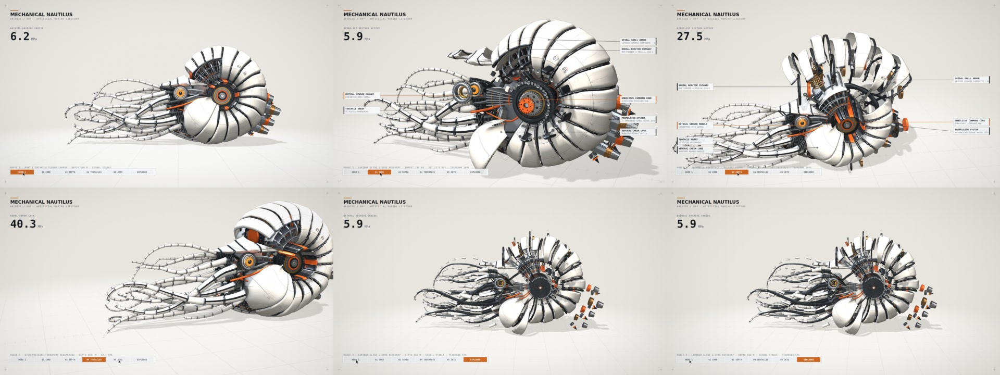
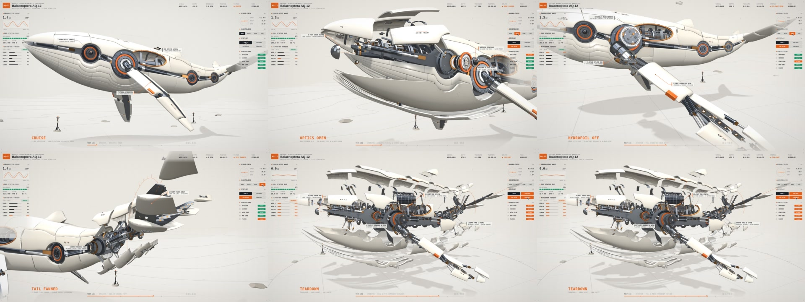
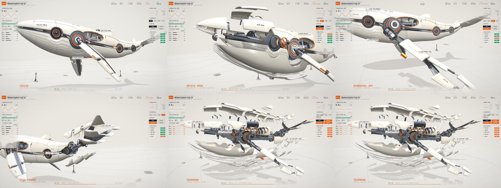
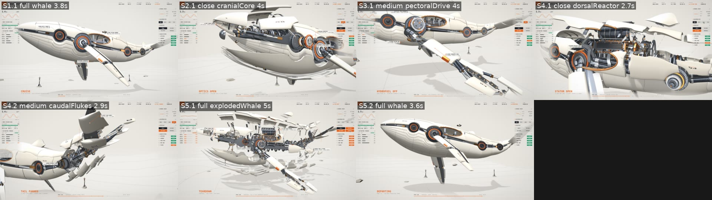
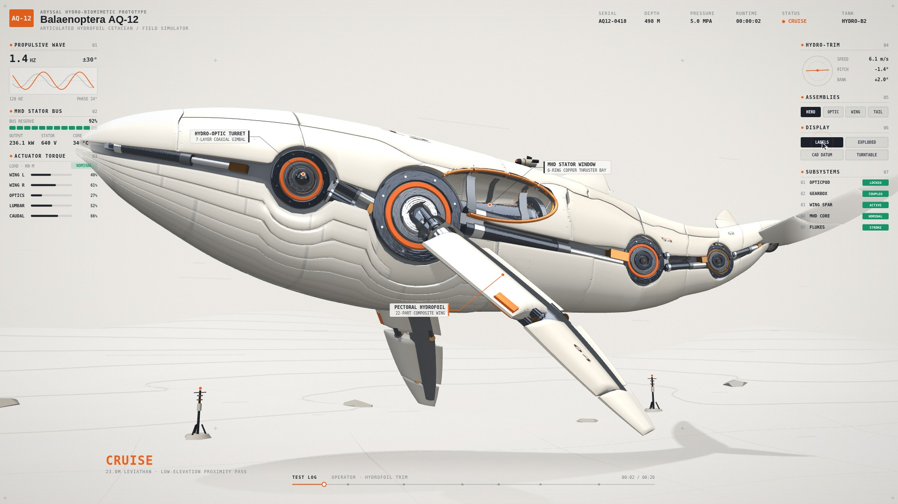
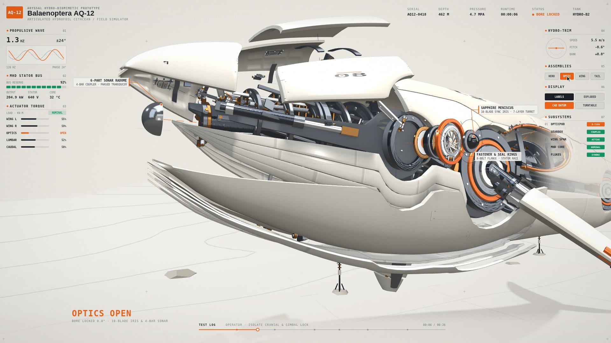
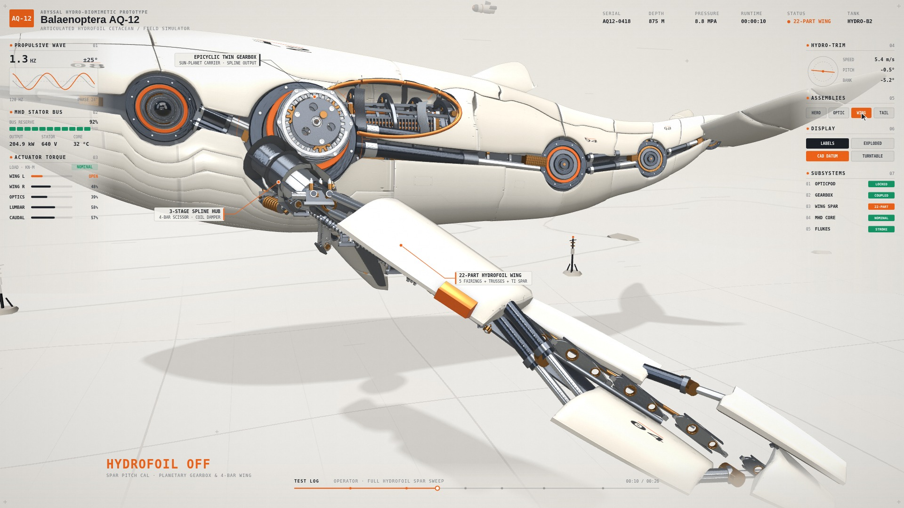
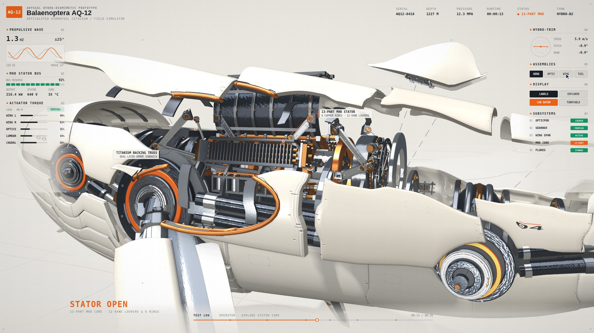
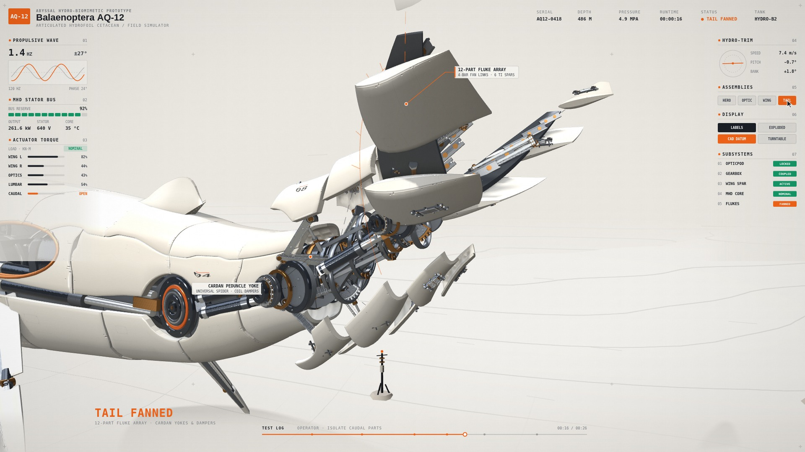
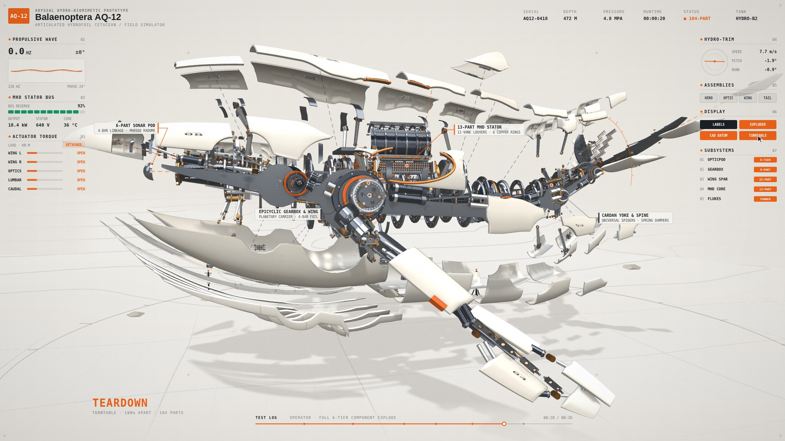

# Calibration Lab · 计量实验室

> 无缝浅色摄影棚 · 阳极氧化铝与刻线台面 · 剖切/分阶段爆炸 · 同源仪表 HUD
> 一个风格，一个仓库：HTML-in-Canvas 多场景 + Three.js 3D 舞台 + WebGL2 颗粒 pass + 确定性渲染 + 程序化机械配乐。  
> Created by **Star Dinosaur (星星恐龙)** · MIT



默认样片《机械鹦鹉螺》共 5 个场景、26 秒，由 `styles/calibration-lab/world.js` + `sample/` 组成；同时仓库内置第二套完整重工旗舰样片《深海声学须鲸 Balaenoptera AQ-12》（[`styles/calibration-lab/whale/`](styles/calibration-lab/whale/README.md)，共 5 个场景、7 个镜头、26 秒，支持 `minimal` 标准档与 `kinetic` V10 复杂重工满舱档 `5,632` 内舱零件一键切换）。

---

## 旗舰复杂样片展示 · 深海声学须鲸（Balaenoptera AQ-12 · V10）

> 完整文档与 V1–V10 工程复盘见 [`styles/calibration-lab/whale/README.md`](styles/calibration-lab/whale/README.md) · [`NOTES.md`](styles/calibration-lab/whale/NOTES.md) · [`lineage/mech-whale/`](styles/calibration-lab/lineage/mech-whale/README.md)



### 双复杂度档位对比：标准档（`minimal` / V7）vs. 复杂重工满舱档（`kinetic` / V10）

| 标准档（`minimal` · V7 基线 · 184 件 6 层模块化拆解） | 复杂重工满舱档（`kinetic` · V10 默认 · 5,632 件三层内构） |
| :-: | :-: |
|  |  |

### 7 镜头分镜与关键帧（26.0s · 5 Scenes / 7 Shots）



| S1.1 · `CRUISE`（巡航入场） | S2.1 · `OPTICS OPEN`（头锥与 28 片机械鲸须百叶） |
| :-: | :-: |
|  |  |
| **S3.1 · `HYDROFOIL OFF`（22 件水翼与行星减速机匣）** | **S4.1 · `STATOR OPEN`（MHD 紫铜定子与汇流母线排）** |
|  |  |
| **S4.2 · `TAIL FANNED`（十字万向尾椎与 12 件扇展尾翼）** | **S5.1 · `TEARDOWN`（全舰 5,632 件大爆炸转台检视）** |
|  |  |

---

## 它是什么

- **kernel（工具箱）**：`styles/calibration-lab/kernel.js` 提供机器感原语——世界空间剖切（`cutWindow` / `windowRim`）、刻线台面、环组/散热鳍/联动机构（四连杆、行星差速轮系、同步光圈、正交十字万向节）、材质角色（metal / glaze / liner / emissive）、分阶段爆炸、LOD 与同源仪表 HUD。每个元素都必须带参数，没有默认摆放。
- **world（双样片示例）**：
  - `styles/calibration-lab/world.js` + `sample/`（GLB 外壳、运动学、配色、teardown kit 兼容层）：默认样片《机械鹦鹉螺》。
  - [`styles/calibration-lab/whale/`](styles/calibration-lab/whale/README.md)：重工多级拆解样片《深海声学须鲸 Balaenoptera AQ-12》，展示 `resolveMechProfile` 双档参数化体系（`minimal` 标准档 vs `kinetic` 复杂档 `5,632` 件三层内构）。
- **规格**：`styles/calibration-lab/SPEC.md`（去固化铁律、API、剖切/爆炸/仪表规则、§9 自检清单与 3D 门禁）。
- **来历**：`styles/calibration-lab/lineage/mech-nautilus/` 保留机械鹦鹉螺从早期 → 重做 → 迭代的过程图与说明；[`styles/calibration-lab/lineage/mech-whale/`](styles/calibration-lab/lineage/mech-whale/README.md) 记录深海声学须鲸从 `V1`–`V10` 的演进脉络与双复杂度分档决策。
- **声音**：`tools/sound.py` 的 `mech` 预设——液压泵/流体床、循环动力冲程、伺服/气阀过渡与机械拟音；无音乐铺底、无高频铃声。`styles/calibration-lab/samples.json` 可把 `brass_ratchet` / `count_tick` / `scale_tilt` / `card_enter` / `layer_float` 叠到 CC0 录音 one-shot 上；缓存缺失时自动纯合成。

## 快速开始

```bash
npm install                      # 仅依赖 playwright-core
# 需要 Chrome 157+（151–154 走 legacy 兼容路径）；用 CHROME_BIN 或 PLAYWRIGHT_CHROME 指定可执行文件，
# 否则自动探测 ~/.cache/ms-playwright/chromium-*/chrome-linux64/chrome
# 声音与成片还需要 python3（numpy、scipy）与 ffmpeg

npm run init                     # 可选：下载 CC0 采样（VCSL / VSCO-2-CE，sha256 校验）到 .cache/samples/；缺省则声音退回纯合成

npm run serve                    # Studio：http://127.0.0.1:8080/gallery/

# 体检：运行时报错、文字越界、字号、停留时长、浮层遮挡 + 3D 主体构图（默认 16:9 / 9:16 / 1:1）
node tools/audit.mjs --style calibration-lab --all-sizes

# 渲染 2×2 检视表（测试产物放在 out/test/ 下，已由 .gitignore 忽略）
node tools/render.mjs --style calibration-lab --sheet out/test/scratch/nautilus_sheet.jpg

# 渲染成片（成品放在 out/products/<slug>/v<N>/ 下）
node tools/render.mjs --style calibration-lab --video out/products/mech-nautilus/v1/calibration-lab.mp4 --fps 30 --workers 2

# 画面回归：与 styles/calibration-lab/look_baseline.* 对比，有意改动后 --accept
python3 tools/lookcheck.py --style calibration-lab

# 3D 门禁：剪影 / 机器感 / 颜色层（需要分镜无损帧与 subject mask）
node tools/render.mjs --style calibration-lab --world <product>/world.js --storyboard <out>/storyboard.jpg --shots-dir <out>/shots
python3 tools/lookcheck.py --style calibration-lab --world <product>/world.js --content <product>/scenes.html --gates

# 运行内置第二样片《深海声学须鲸 Balaenoptera AQ-12》（默认 V10 复杂重工档，或加 --look '{"mech":"minimal"}' 切换标准档）
node tools/audit.mjs --style calibration-lab --world styles/calibration-lab/whale/world.js --content styles/calibration-lab/whale/scenes.html --all-sizes
node tools/render.mjs --style calibration-lab --world styles/calibration-lab/whale/world.js --content styles/calibration-lab/whale/scenes.html --sheet out/test/scratch/whale_sheet.jpg

# 可选：人声轨（TTS 是构建步骤，默认关闭；依赖见 requirements-voice.txt）
node tools/render.mjs --style calibration-lab --video <out>.mp4 --voice <dir>/voice.json
```

本地渲染输出统一归口在 `out/`（分为 `out/test/` 测试与 `out/products/<slug>/v<N>/` 成品两类），非公开决策与计划文档放在 `devdocs/`，两者均在 `.gitignore` 中忽略。

## 目录

```text
engine/     运行时：stage.js · motion.js · studio3d.js · camera.js · director.js · look.js · gtao.js · three_bridge.js · vendor/three.min.js · passes/grain.js · base.css …（见 engine/README.md）
gallery/    Studio（index.html + player.html + catalog.js，只列 calibration-lab）
styles/calibration-lab/
            style.js · kernel.js · world.js · scenes.html · theme.css · SPEC.md · ref.json · samples.json
            contact_sheet.jpg · look_baseline.{jpg,json} · sample/（机械鹦鹉螺：hull.glb + 运动学/配色/kit-compat）
            whale/（深海声学须鲸 AQ-12：V10 5,632 件重工联动 + 标准档双模式 + 剧照与 NOTES.md）
            lineage/mech-nautilus/ · lineage/mech-whale/
tools/      audit.mjs · render.mjs · lookcheck.py · sound.py · samples.py · samples.manifest.json · audio_grains.py · textures.py · voice.py · factcheck.mjs
assets/     textures/brushed_metal.png（台面 `u_paper` 纹理；由 tools/textures.py 生成）
```

声音颗粒 `assets/audio/*.wav` 由 `tools/audio_grains.py` 在首次合成时自动生成（被 `.gitignore` 忽略，不入库）。

## 许可

MIT，见 [`LICENSE`](LICENSE)；第三方声明见 [`CREDITS.md`](CREDITS.md)、[`LICENSE-THIRD-PARTY`](LICENSE-THIRD-PARTY) 与 [`SOUND_CREDITS.md`](SOUND_CREDITS.md)。
