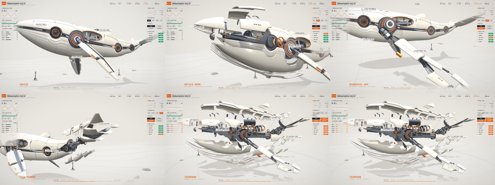
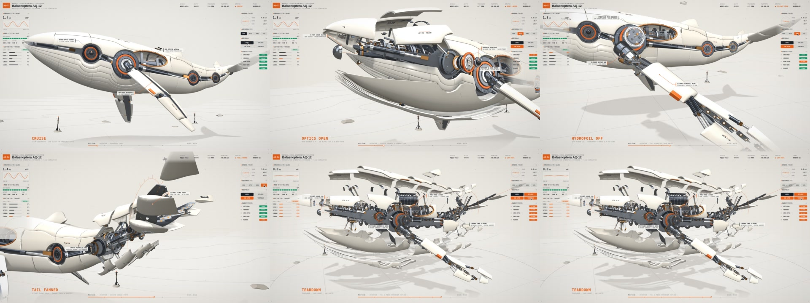
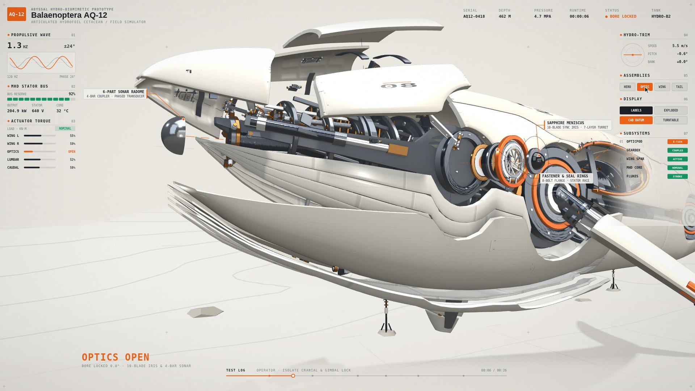
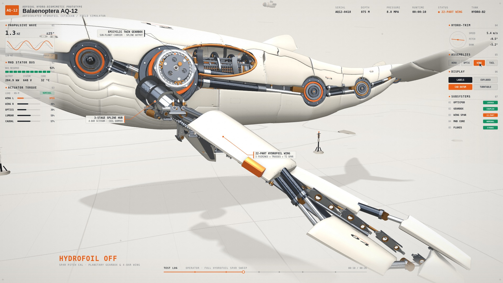
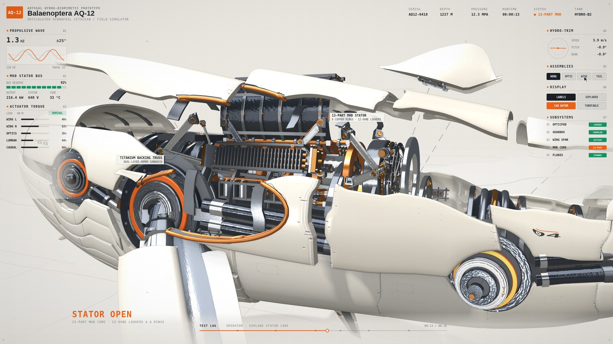
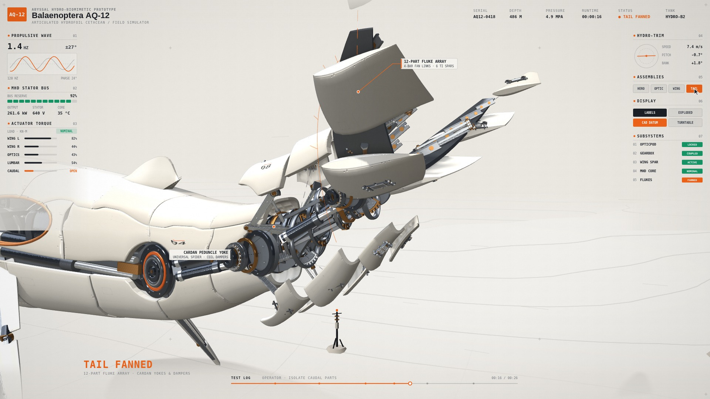

# 深海声学须鲸 Balaenoptera AQ-12 · 双档机械复杂度演进脉络

继默认样片《机械鹦鹉螺》（[`../mech-nautilus/`](../mech-nautilus/README.md)）验证了 `calibration-lab` 的基础机器感原语后，我们以 23 米级深海合成孔径须鲸 **Balaenoptera AQ-12** 为载体，完成了从 `V1` 到 `V10` 的十轮工程迭代，并将内核扩展出 **`minimal`（常规标准档）** 与 **`kinetic`（重工满舱复杂档）** 双档参数化体系（`kernel.js` §10）。

| V7 标准档 (`minimal`) | V10 复杂重工档 (`kinetic` · 5,632 内舱零件) |
| :-: | :-: |
|  |  |

## 怎么走过来的（V1 → V10 三阶段演进）

- **第一阶段：三维生物解剖还原与流线分甲（`V1`–`V5`）**
  - **早期踩坑**：最初按参数曲面等距切格子、外表面堆砌无传动关系的装饰齿轮，甚至为凑 2D 侧视剪影把左右胸鳍做成不对称、把鲸鱼水平双叶尾翼做成竖扁鱼尾。
  - **工程重构**：在 [`generate_whale_glb.py`](../../whale/generate_whale_glb.py) 中重写 1:2.15 须鲸头身比、30°/45° 流体折角分缝、45° 实体倒角白瓷外甲与鱼鳞叠压；胸鳍改为从肩部 7 环轴承圆心同轴穿出的三层水翼叠甲，尾翼还原为水平双叶新月形水翼，并建立无死区的全局连续推进波与 7 对喉腹褶甲风琴式呼吸律动。
- **第二阶段：全零件六层爆炸、海床试验场与“标准档”定型（`V6`–`V7` · `minimal` 档）**
  - 建立 **6 层级 184 件模块化全分解系统**（白瓷外甲 → 钛合金冲压背衬桁架 `truss__*` → 22 件水翼胸鳍 → 10 座同轴轴承轮毂 → 四大封装核心总成 → 跨骨液压作动筒），配合 `280m × 280m` 浅雾大陆架海床试验场、`1.95m` 测距信标塔与 `0.88m` 伴飞潜航器锚定 680 吨巨物尺度。
  - 至 `V7` 时，画面清爽利落、拆解层次分明，成为**常规标准产出（Standard / `minimal` 档）**的定型基线。
- **第三阶段：ILM 三层机械词库与重工满舱联动（`V8`–`V10` · `kinetic` 档）**
  - 为探索工业光魔（ILM《变形金刚》）式“开舱即见千件精密咬合”的极限密度，我们在 `kernel.js` §10 中提炼出四套零物种词通用联动原语（`foldingLinkageRig` 四连杆、`planetaryDriveRig` 行星差速轮系、`syncIrisRig` 凸轮同步光圈/百叶、`cardanGimbalRig` 正交十字万向节），并在 `V9`–`V10` 引入三层机械词库与 2.5× 物理截面加粗：
    - 全船 24 道 CNC 工字钛合金肋骨笼、口腔 28 片联动机械鲸须百叶阵列、32 柱相控阵声呐换能器；
    - 水翼内部 9 级展向 CNC 镂空航空翼肋、肩部开顶双级行星减速机匣、24 珠外露滚珠回转支承轴承；
    - 背部 MHD 反应堆 6 道外环肋装甲盖、4 根粗紫铜汇流母线排、两侧脉冲电容柜与尾椎上下双扇形驱动齿盘。
  - 最终内舱独立可动/可见机构达 **`5,632` 件**，且在巡航合拢态（`S1.1` / `S5.2`）下 100% 物理遮蔽于流线白甲之内，全 7 镜通过 `lookcheck.py --strict-gates`。

| S2.1 头锥与机械鲸须百叶 | S3.1 水翼 CNC 翼肋与行星减速箱 | S4.1 MHD 紫铜定子与汇流排 | S4.2 万向尾椎与扇展尾翼 |
| :-: | :-: | :-: | :-: |
|  |  |  |  |

## 为什么在 V10 收官并确立“双档策略”

在 `V10` 完成后，我们做出了两个关键工程决策：
1. **坚守 `calibration-lab` 的审美边界，在 V10 正式收官**：不再向暗黑风化重金属、常态外露液压肌群或熔炉红光等“史诗怪兽”方向改写外甲，保持高明度工程白瓷与洁净标定实验室的克制气质。
2. **确立 `minimal`（标准档）与 `kinetic`（复杂档）双档并存**：并非所有科普或工程演示都需要 5,600+ 件重工内构——日常通用场景使用清爽利落的 `minimal` 档（V7），而在需要极致机械密度与特写拆解震撼感时切换 `kinetic` 档（V10）。

## 源码与文档

完整可运行源码、分镜剧照与十轮迭代技术复盘位于 [`../../whale/`](../../whale/README.md)（架构复盘详见 [`../../whale/NOTES.md`](../../whale/NOTES.md)）。
