# Balaenoptera AQ-12 · 深海声学合成孔径须鲸

> **Archive / 012 · Articulated Hydrofoil Cetacean / Hydro-Mech Field Simulator**  
> 5 幕 7 镜头 · 26.0s 确定性水动力学标定试验场与多级全分解展示 · 支持 **标准档 (`minimal` / V7)** 与 **复杂重工满舱档 (`kinetic` / V10 · 5,632 内舱零件)** 一键切换。

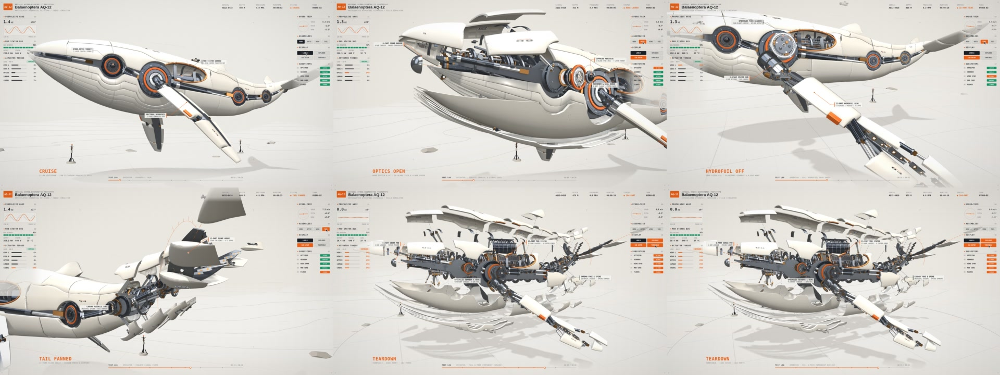

---

## 1. 剧目编排与分镜总览（5 Scenes / 7 Shots / 26.0s）

全片置于 `280m × 280m` 浅雾大陆架海床试验场（带等深测绘线、`1.95m` 声呐测距信标塔与 `0.88m` 伴飞标定潜航器 `AQ-ROV-02`），以 `45°` 广角电影焦段完成五幕完整检视：

| 镜头 | 场景与时间段 | 标定模式 | 核心动作与机械检视内容 |
| :-: | :-- | :-- | :-- |
| **S1.1** | `Scene 01` · `0.0–3.8s` | `BANKING → CRUISE` | `+18°` 侧倾入画，低仰角抵近掠过海床沙脊与测距信标，展示 23 米流线型白瓷外甲与连续全身推进波 |
| **S2.1** | `Scene 02` · `3.8–7.8s` | `OPTICS OPEN` | 头部声呐与光学舱鸥翼展开：7 层同轴光学转塔（10 叶凸轮同步光圈）两段式伺服寻的与 `0.0°` 光轴锁定、6 件相控阵声呐头锥与口腔 28 片机械鲸须百叶阵列 |
| **S3.1** | `Scene 03` · `7.8–11.8s` | `HYDROFOIL OFF` | 双侧水翼胸鳍 22 件全分解：肩部开顶双级行星减速机匣、24 珠回转支承轴承、9 级展向 CNC 镂空翼肋骨架与中央钛合金主翼梁满行程俯仰扫描 |
| **S4.1** | `Scene 04a` · `11.8–14.5s` | `STATOR OPEN` | 背脊 MHD 磁流体推进舱 13 件拆解：双层夹心背甲与环肋机匣盖掀开，6 枚实心紫铜定子环、高速凹槽转子、粗紫铜汇流母线排与 12 叶同步散热百叶 |
| **S4.2** | `Scene 04b` · `14.5–17.4s` | `TAIL FANNED` | 尾柄与水平双叶尾翼 12 件扇展：双级正交十字万向节、上下扇形大模数驱动齿盘、螺旋弹簧阻尼器与 6 道尾翼翼肋笼全幅展开 |
| **S5.1** | `Scene 05a` · `17.4–22.6s` | `TEARDOWN + TURNTABLE` | 全舰 6 层级大爆炸 + `58°` 三维转台检视：全船白瓷外甲、钛合金背衬桁架、24 道 CNC 工字肋骨笼与内舱 `5,632` 件联动机构全数展开 |
| **S5.2** | `Scene 05b` · `22.6–26.0s` | `REASSEMBLY → DEPARTING` | 全舰零件顺滑吸合归位，`-22°` 侧倾大摆幅推进加速驶离标定试验场 |

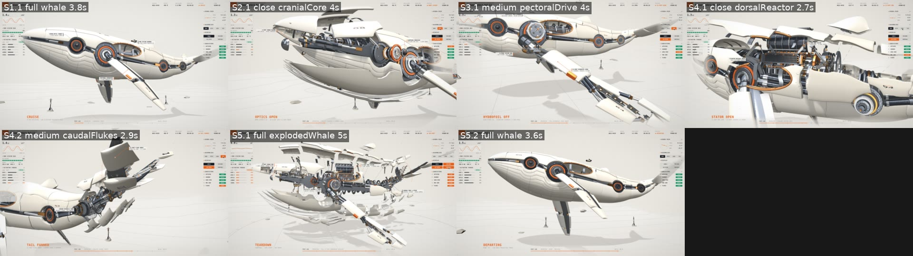

---

## 2. 双复杂度档位对比：标准档 (`minimal` / V7) vs. 复杂重工满舱档 (`kinetic` / V10)

本项目作为 `calibration-lab` 内核的双档位标杆样片，通过 `resolveMechProfile` 支持两种工程复杂度产出（详见 [`NOTES.md` §15](NOTES.md)）：

| 维度 | 标准档 (`minimal` · V7 基线) | 复杂重工满舱档 (`kinetic` · V10 默认) |
| :-- | :-- | :-- |
| **切换参数** | `--look '{"mech":"minimal"}'` | 默认启用（或 `--look '{"mech":"kinetic"}'`） |
| **设计定位** | 一般场景下的常规标准产出：以干净流线型 6 层 184 件模块化外甲、核心龙骨与四大主总成拆解为主，视觉清爽利落 | 特写检视与重工拆解展示的“复杂参数版”：启用工业光魔（ILM）三层机械词库与 2.5× 加粗重工满舱内构 |
| **内舱机构规模** | 4 大封装式核心总成 + 5 道工字主隔框 + 跨骨液压作动筒 | **5,632 件**独立三维机构网格 + 数千枚 `InstancedMesh` 滚珠/翅片/紧固件 |
| **专有重工总成** | 标准模块化拆解 | 24 组重型锻造四连杆、全船 24 道 CNC 肋骨笼、28 片联动机械鲸须百叶、9 级 CNC 水翼翼肋、肩部双级行星齿轮箱、10/12 叶同步凸轮光圈、正交十字万向节、粗紫铜汇流母线排与铠装波纹管束 |
| **巡航合拢态外观** | 100% 物理遮蔽，纯净白瓷流线留白（`cells = 0.59..1.21`） | 100% 物理遮蔽，与标准档合拢态逐像素一致（`open = 0.000`） |

| 标准档 (`minimal` · V7 基线) | 复杂重工满舱档 (`kinetic` · V10) |
| :-: | :-: |
| 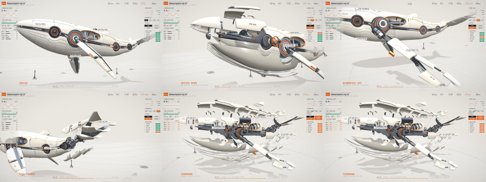 |  |

---

## 3. 1080p 分镜关键帧与三视图工程校验

### 7 镜 1080p 渲染帧（V10 `kinetic` 档）

| S1.1 · `CRUISE` (巡航入场) | S2.1 · `OPTICS OPEN` (头锥与鲸须百叶舱) |
| :-: | :-: |
| 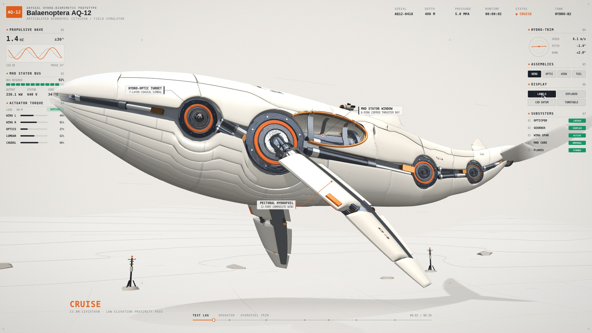 | 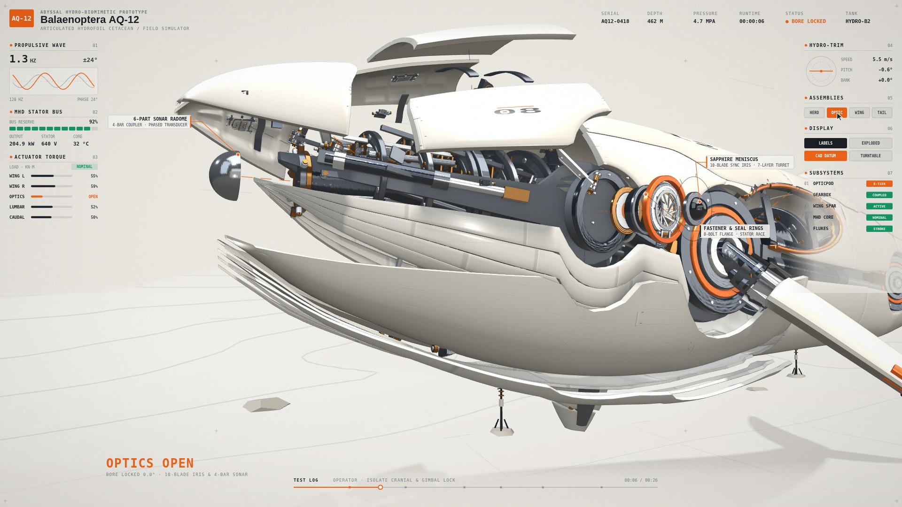 |
| **S3.1 · `HYDROFOIL OFF` (22 件水翼与行星减速箱)** | **S4.1 · `STATOR OPEN` (MHD 紫铜定子与汇流排)** |
| 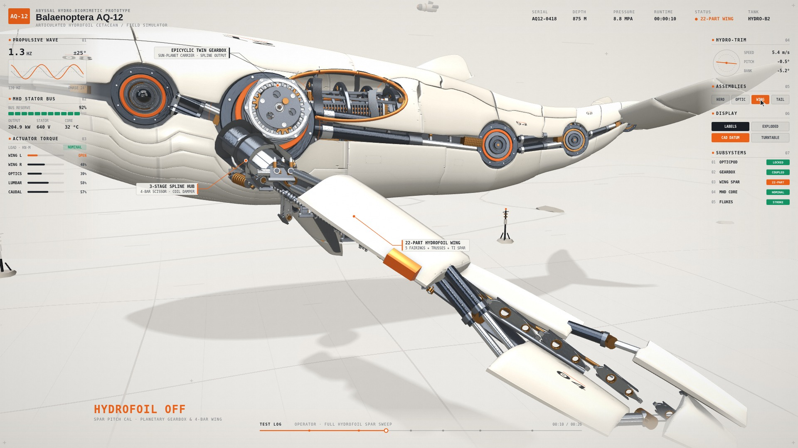 | 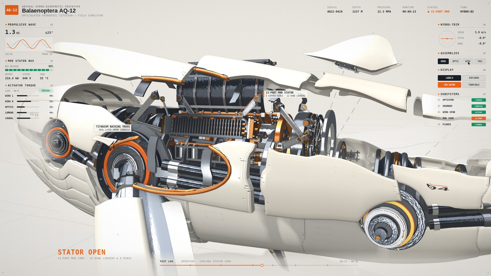 |
| **S4.2 · `TAIL FANNED` (万向尾椎与 12 件扇展尾翼)** | **S5.1 · `TEARDOWN` (全舰 5,632 件大爆炸转台)** |
| 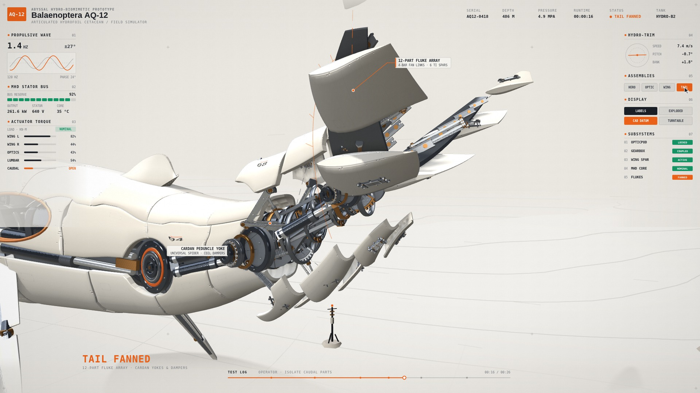 | 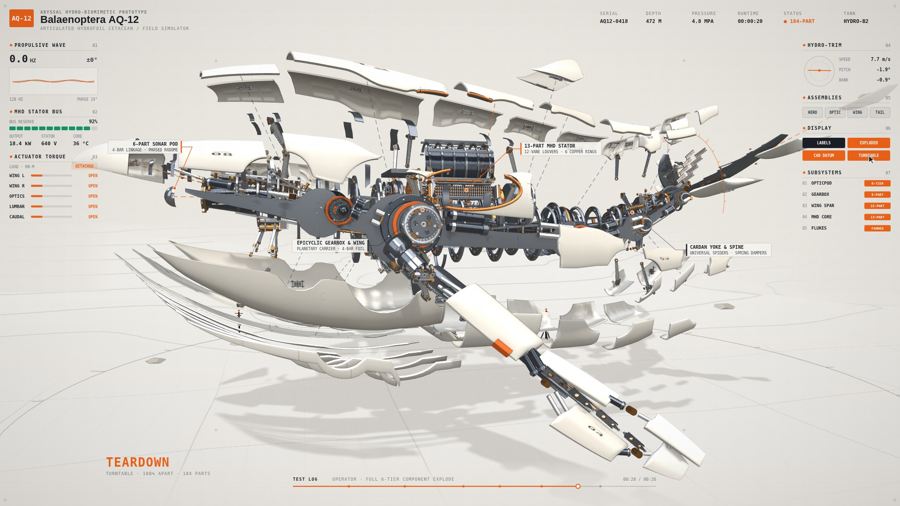 |

| S5.2 · `DEPARTING` (全舰吸合与低仰角离场) | 三视图与等轴测工程校验 (`--look '{"threeView":true}'`) |
| :-: | :-: |
| 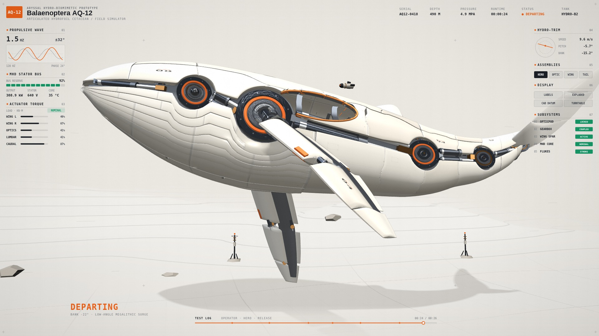 | 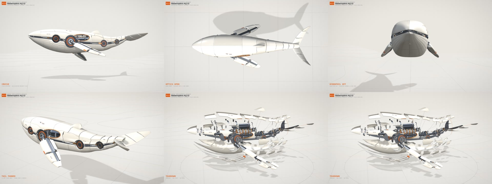 |

---

## 4. 在 Studio 与 CLI 中运行

### Studio 交互工作台

启动本地开发服务器后（`npm run serve`），可通过 Studio 左侧 **Sample · 样片切换** 一键切换，或直接访问以下地址：

- **Studio 工作台（复杂档 V10）**：`http://127.0.0.1:8080/gallery/?style=calibration-lab&sample=whale-v10`
- **Studio 工作台（标准档 Minimal）**：`http://127.0.0.1:8080/gallery/?style=calibration-lab&sample=whale-minimal`
- **独立舞台播放器（V10）**：`http://127.0.0.1:8080/gallery/player.html?style=calibration-lab&world=/styles/calibration-lab/whale/world.js&content=/styles/calibration-lab/whale/scenes.html`

### CLI 体检、渲染与 ADR-021 门禁命令

```bash
# 1. 三画幅版面与 3D 构图体检（16:9 / 9:16 / 1:1）
node tools/audit.mjs --style calibration-lab \
  --world styles/calibration-lab/whale/world.js \
  --content styles/calibration-lab/whale/scenes.html \
  --all-sizes

# 2. 渲染 V10 复杂档（默认 kinetic）2×2 检视表与 7 镜分镜表
node tools/render.mjs --style calibration-lab \
  --world styles/calibration-lab/whale/world.js \
  --content styles/calibration-lab/whale/scenes.html \
  --sheet out/test/scratch/whale/contact_sheet.jpg \
  --storyboard out/test/scratch/whale/storyboard.jpg \
  --shots-dir out/test/scratch/whale/gate_shots

# 3. 切换为 V7 标准档（minimal）渲染检视表
node tools/render.mjs --style calibration-lab \
  --world styles/calibration-lab/whale/world.js \
  --content styles/calibration-lab/whale/scenes.html \
  --look '{"mech":"minimal"}' \
  --sheet out/test/scratch/whale/contact_sheet_minimal.jpg

# 4. 渲染三视图工程校验图
node tools/render.mjs --style calibration-lab \
  --world styles/calibration-lab/whale/world.js \
  --content styles/calibration-lab/whale/scenes.html \
  --look '{"threeView":true}' \
  --sheet out/test/scratch/whale/three_view_check.jpg

# 5. 运行 ADR-021 3D 视觉门禁（剪影 / 机器感 / 金属明度 / 颜色层）
python3 tools/lookcheck.py --style calibration-lab \
  --world styles/calibration-lab/whale/world.js \
  --content styles/calibration-lab/whale/scenes.html \
  --shots-dir out/test/scratch/whale/gate_shots \
  --gates --strict-gates

# 6. 渲染 1080p 30fps 完整成片（含程序化水下重工机械配乐）
node tools/render.mjs --style calibration-lab \
  --world styles/calibration-lab/whale/world.js \
  --content styles/calibration-lab/whale/scenes.html \
  --video out/products/mech-whale/v10/mech_whale_showreel.mp4 --fps 30 --workers 2
```

---

## 5. 目录结构与设计复盘

```text
styles/calibration-lab/whale/
├── world.js                        # 五幕导演运镜、时间线编排、灯光与双档 mechProfile 入口
├── scenes.html                     # 5 幕场景时间轴声明（26.0s）
├── ref.json                        # 舞台调色板、自由安全区与标定参数
├── palette.js                      # 工程白瓷、钛合金、拉丝钢、锡青铜、紫铜与信号橙材质定义
├── kin.js                          # 连续流体推进波、风琴呼吸波與多模态自检运动学
├── whale-model.js                  # 7 骨骼层级关节链、6 层 184 件模块化外甲与四大总成拆解
├── whale-linkages.js               # V8 四大核心联动机构（四连杆、行星齿轮、同步光圈、十字万向节）
├── whale-tier-factory.js           # V9/V10 三层机械词库与 InstancedMesh 微零件工厂
├── whale-bays-fore.js              # V10 前舱重工总成（24 道肋骨笼、28 片机械鲸须、32 柱相控阵、9 级水翼翼肋）
├── whale-bays-aft.js               # V10 后舱重工总成（环肋装甲罩、紫铜汇流母线排、脉冲电容柜、尾椎扇形齿盘）
├── whale-env.js                    # 280m×280m 浅雾大陆架海床试验场、1.95m 信标塔与 0.88m 伴飞 ROV
├── whale-hud.js                    # Field Simulator 双侧无框遥测仪表与动态圆点引线标注
├── generate_whale_glb.py           # Blender 参数化三视图雕塑外壳生成脚本（输出 hull.glb）
├── hull.glb                        # 45° 实体倒角分块白瓷外甲与内层钛合金背衬桁架网格
├── NOTES.md                        # V1 → V10 完整工程迭代复盘、反模式诊断与架构规范
├── contact_sheet.jpg               # V10 复杂档（kinetic）2×2 检视表
├── contact_sheet_v7_standard.jpg   # V7 标准档（minimal）2×2 检视表
├── storyboard.jpg                  # 7 镜头分镜总览图
├── three_view_check.jpg            # 三视图与等轴测工程校验图
└── img/shot_000.jpg .. shot_006.jpg # 7 张 1080p 关键帧剧照
```

完整的设计规范、历次反模式排查与 V1–V10 演进记录见 [`NOTES.md`](NOTES.md)；精简演化脉络见 [`../lineage/mech-whale/README.md`](../lineage/mech-whale/README.md)。
